<!-- Generated from profile.yml by .design/make.py. Edit profile.yml, not this file. -->

  

  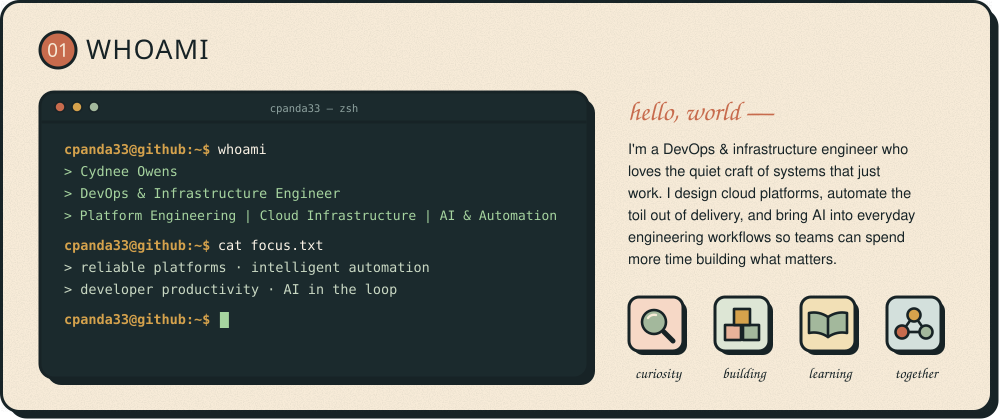

  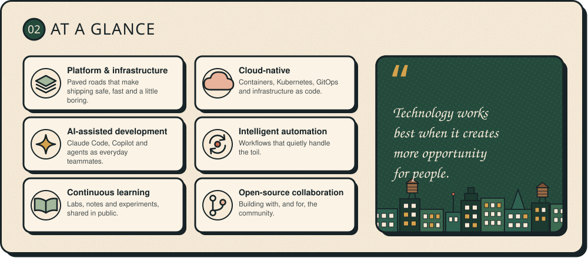

  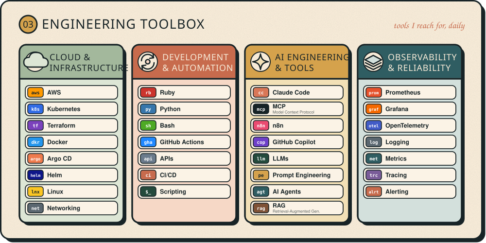

  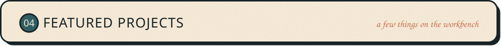

  <a href="https://github.com/cpanda33/infra-foundations">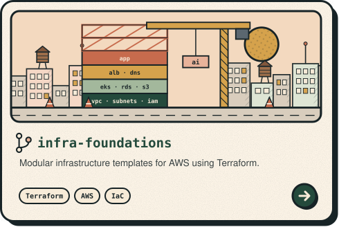</a>
  <a href="https://github.com/cpanda33/ai-automation-lab">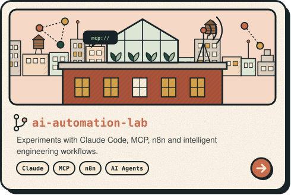</a>

  <a href="https://github.com/cpanda33/devops-toolkit">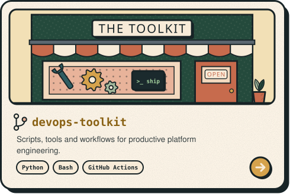</a>
  <a href="https://github.com/cpanda33/learning-in-public">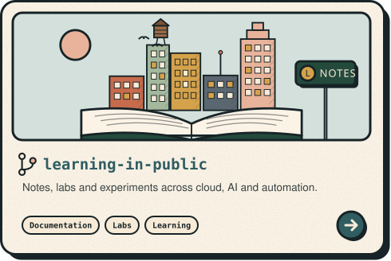</a>

  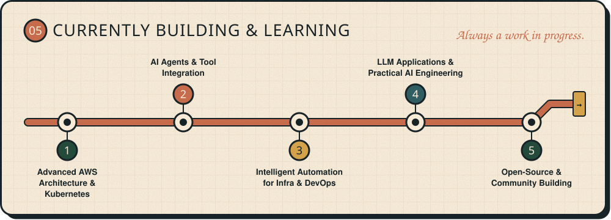

  

  

  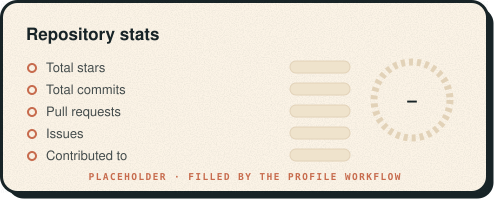
  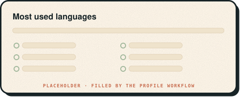

  

  
  
  

  

